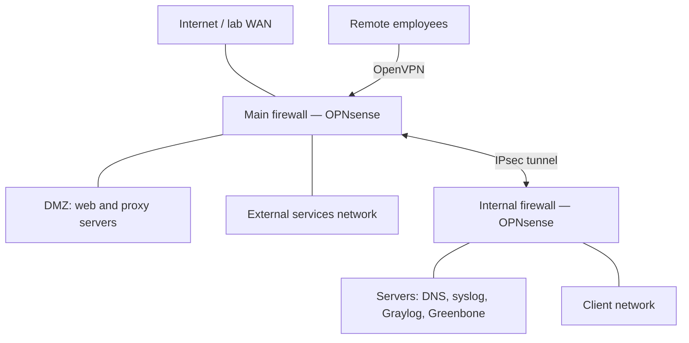

# Practical Network Defense — Firewalling, VPNs & Network Hardening

Team project developed for the **Practical Network Defense course at Sapienza University of Rome**, academic year **2024–2025**.

Working in a professor-provided virtual enterprise environment, our team configured and secured the network of the fictional **ACME company** through three progressive assignments: firewall policy enforcement, secure VPN connectivity, and network hardening. The project provided hands-on experience in **network security engineering, network segmentation, access control, PKI, intrusion detection and prevention, and centralized logging**.

## Project Overview

| Assignment | Focus | Documentation |
| --- | --- | --- |
| **1. Network configuration & firewalling** | Configure network services and translate ACME's security policy into OPNsense firewall rules. | [Requirements](<Assignment 1/PND2425_Assignment_1.pdf>) · [Team report](<Assignment 1/Consegna/ACME_09_a1_report.pdf>) |
| **2. Remote-access & site-to-site VPNs** | Deploy OpenVPN for remote employees and an IPsec tunnel between the two firewall-routers. | [Requirements](<Assignment 2/PND2425_Assignment_2.pdf>) · [Team report](<Assignment 2/Consegna/ACME_09_a2_report.pdf>) |
| **3. Network hardening** | Define and implement a protection plan covering detection, administration, logging, and encrypted services. | [Requirements](<Assignment 3/PND2425_Assignment_3.pdf>) · [Team report](<Assignment 3/Consegna/ACME_09_a3_report.pdf>) |

The deliverables include technical reports and **OPNsense XML configuration exports** for the Main and Internal firewalls at each assignment stage.

## Lab Architecture

The environment ran on **Proxmox VE**, with two **OPNsense firewall-routers** separating the WAN, DMZ, external services, internal servers, and client networks.

This diagram summarizes the topology after the VPN assignment; firewall rules determine which traffic may cross each boundary.

## Assignment 1 — Network Configuration & Firewall Policy

We configured **IPv4 and IPv6 connectivity**, core network services, and inter-zone access controls according to the supplied security requirements.

- **Dual-stack networking:** IPv6 DHCPv6 prefix delegation, SLAAC, interface tracking, and connectivity troubleshooting across both routers.
- **Network services:** internal DNS resolution with dnsmasq, an Apache HTTP/HTTPS service, and syslog collection with a dedicated log server and Graylog.
- **Firewall policy:** interface and floating rules, reusable aliases, and a default-deny approach with explicit service permissions.
- **NAT and traffic forwarding:** outbound NAT through the Main firewall, inbound web-service publication, and the required port `65000` to proxy port `80` redirection.
- **Access restrictions:** SSH administration from the client network, proxy-mediated client web access, and controlled reachability of internal services.
- **Monitoring and diagnostics:** access for the Greenbone vulnerability scanner, ICMP and traceroute rules, and ICMP redirect hardening.

Testing covered DNS resolution, service reachability, NAT behavior, log delivery, and selected allowed and blocked traffic flows.

## Assignment 2 — OpenVPN & IPsec

### Remote Access with OpenVPN

We configured the Main firewall as an **OpenVPN remote-access gateway**, using **X.509 certificates and a Public Key Infrastructure (PKI)**. The setup included a certificate authority, server and client certificates, exported client profiles, and firewall rules implementing differentiated access:

| User | Role | Permitted networks |
| --- | --- | --- |
| Alice | Standard user | DMZ |
| Bob | Power user | DMZ and internal servers |
| Christina | Administrator | All company networks |

Client connection tests and destination reachability checks were used to assess the access rules.

### Site-to-Site Connectivity with IPsec

We deployed a **route-based IPsec VPN** between the Main and Internal firewalls to protect communication across the simulated insecure inter-office link. The configuration used **Virtual Tunnel Interfaces (VTIs)**, tunnel gateways, and static routes, with IPv4 and IPv6 tunnel configurations.

The work included configuring ESP, IKE/ISAKMP, and NAT-T permissions, resolving conflicts between automatic policy installation and route-based forwarding, and checking tunnel status and traffic through OPNsense Live View.

## Assignment 3 — Network Hardening

We developed a **defense-in-depth protection plan** addressing the management, control, and data planes:

- **Suricata IDS/IPS:** enabled on the Main firewall's WAN interface, with relevant detection rule feeds, the ACME home-network definition, and syslog alerts. Configuration included adapting hardware-offload and pattern-matching settings to the virtual environment.
- **Credential hardening:** replaced default passwords on firewalls, hosts, and administrative services.
- **Secure administration:** switched both OPNsense dashboards to HTTPS, enabled HSTS, and disabled automatic HTTP redirection.
- **Time synchronization:** configured NTP on both firewalls to support consistent log timestamps and auditing.
- **Centralized logging:** configured firewall log forwarding to Graylog and the dedicated syslog server.
- **TLS hardening:** restricted the Apache web server to TLS 1.2 and TLS 1.3, disabling TLS 1.0 and TLS 1.1.

The report documents configuration changes and implementation challenges; it does not provide a quantitative benchmark of IDS/IPS detection or prevention effectiveness.

## Skills & Technologies

**Core technologies:** OPNsense, Proxmox VE, OpenVPN, IPsec, Suricata, Graylog, Greenbone, Apache, dnsmasq, Linux, and FreeBSD-based firewall systems.

The project demonstrates practical experience in **firewall administration, secure network architecture, VPN deployment, certificate management, network monitoring, system hardening, and security policy validation**. It also involved collaborative troubleshooting and technical documentation linking requirements to configuration choices and test evidence.

## Team & Scope

**ACME Group 09:** Vincenzo Milillo, Giorgio Zucconelli, Andrea Altomare, and Salvatore Ruocco.

This project was completed in an authorized university lab. Configuration exports are environment-specific snapshots and require adaptation before reuse.

### Lab Credentials & Reproducibility

The reports and configuration exports intentionally retain lab passwords, certificates, and private keys to document the original setup and support reproduction of the exercises. These materials were used exclusively in this university lab, which has since been decommissioned, and were not reused in personal accounts or other environments.

Treat these published credentials and keys as public test material. Use them only when reproducing the exercises in an isolated lab; generate new credentials, certificates, and private keys for any deployment beyond that context.
